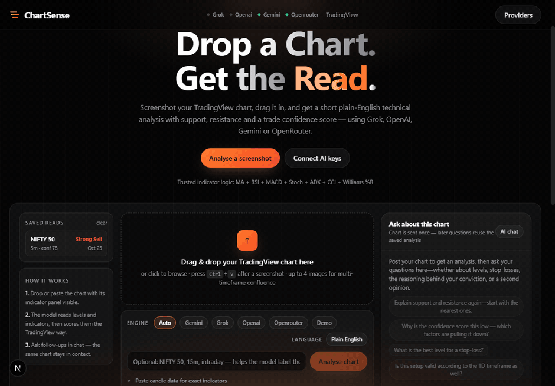

# ChartSense

**Drop a TradingView screenshot, get a plain-English technical read — with levels, a TradingView-style gauge, and a
confidence score you can actually audit.**

Runs entirely on your machine. Your key goes only to the provider you pick. No account, no telemetry, no server of mine.



*The last half of the clip is a real Gemini read of a NIFTY 50 5m chart, opened back out of the saved-reads rail. The
`120 candles` panel is real OHLCV data, which is why every indicator under it is tagged `calculated` instead of guessed.*

---

## The problem with "AI reads my chart"

Ask any vision model for technical analysis and you get confident prose built on numbers it estimated off a
screenshot — an EMA 200 it cannot see, an RSI it invented, a "high confidence" that is just vibes.

ChartSense is built so that never happens silently:

| | |
| --- | --- |
| **Every number carries its source** | `calculated` (exact arithmetic from your candles) · `read` (off the screenshot) · `estimated` (derived from the visible price path, always with a `~`) · `no basis`. Invented price levels are refused, not rounded into existence. |
| **Paste candles and the maths stops being AI** | SMA 10/20/50/100/200, EMA 20/50/200, Wilder RSI(14), MACD(12,26,9), Stochastic(14,3,3), ADX(14) with DI+/DI− and ATR are computed in TypeScript from your data and overwrite whatever the model guessed. |
| **The confidence score is code, not a vibe** | It starts at 50 and adds ten capped factors. A model cannot inflate it: points are clamped per factor, duplicate evidence is counted once, and the total is recomputed server-side. Three of the ten (average alignment, oscillator agreement, ADX) are scored from your candles, so the app writes that explanation itself. |
| **It stays honest at the end** | Educational read only. No news, no fundamentals, no predictions — and every plan ends with *wait for clear price confirmation*. |

Clamped to 5–85 on purpose: one screenshot can never be certain.

## What a real read looks like

```text
NIFTY 50 · 5m · LTP 22395.0
Verdict: Strong Sell (TradingView gauge 15/100) · Signal clarity 78/100 — how clean the read is, not the odds of profit

Nifty 50 is in a firm intraday downtrend after breaking below the 22474.7 breakdown level. Price continues to print
lower highs and lower lows with all key moving averages sloping overhead. A strong ADX reading confirms robust
downward momentum pushing toward lower target levels.

• Support: 22355.5 and 22305.6
• Resistance: 22474.7, 22576.7 and 22719.9

Why this confidence score
   +15 Moving average alignment: Price is trading well below all estimated short and intermediate moving averages.
   +15 Trend strength (ADX): ADX is at 40.28 with DI- dominant at 27.4, indicating a strong downtrend.
   -10 Signal freshness: The sell signal originated at 22583.85 and the move is already quite extended.
    -5 Oscillator agreement: RSI has dipped into oversold territory (28.25), warning of potential short-term pullbacks.
    +8 Level test quality: Clean break and acceptance below the key breakdown trigger at 22474.7.
    +5 Screenshot clarity: Price action, levels, and key HUD indicator values are crisp and fully legible.

If-then plan (not advice)
• Trigger: Rejection on a retest of 22440.0 - 22474.7
• Invalidation: 22500.0
• Target: 22355.5
• Risk : reward: 2.3:1
```

Copy any read as text or download it as `.txt`, then keep asking about the same chart in the chat panel.

## Run it

```bash
npm install
npm run dev          # http://localhost:3000
```

Connect one vision key — click **Connect AI keys**, paste, **Test key**, **Save keys**:

| Provider | Key from | Env var |
| --- | --- | --- |
| Grok (xAI) | console.x.ai | `XAI_API_KEY` |
| OpenAI | platform.openai.com/api-keys | `OPENAI_API_KEY` |
| Gemini | aistudio.google.com/apikey | `GEMINI_API_KEY` |
| OpenRouter | openrouter.ai/settings/keys | `OPENROUTER_API_KEY` |

No key? It runs in **demo mode** — the layout plus real indicator maths on any candles you paste, with zero API calls.

**Test key** probes current vision models and remembers the first that answers. **List vision models** pulls every
image-capable model on your key into a dropdown (an image input is required — a text model cannot read a screenshot).

## How to use it well

1. Screenshot the chart **with the indicator panel visible** (RSI / MACD / ADX / moving averages).
2. Drag it in, click to browse, or hit `Ctrl+V` right after capturing. Up to 4 images gives a multi-timeframe confluence read.
3. Want exact numbers instead of estimates? Open **Paste candle data** and drop in OHLCV rows
   (`date,open,high,low,close,volume` — 200+ rows unlocks SMA 200).
4. Optional hint: `NIFTY 50, 15m, intraday`, so the labels come out clean.
5. Pick **Plain English** or **Hinglish** → **Analyse chart**.

### Which indicator unlocks at how many candles

| Needs | Candles |
| --- | --- |
| SMA 10 / 20, EMA 20, RSI(14), Stochastic(14,3,3), Volume | 20+ |
| ADX(14) with DI+/DI− and ATR | 29+ |
| MACD(12,26,9) — line at 26, signal line at 34 | 34+ |
| SMA 50, EMA 50 | 50+ |
| SMA 100, EMA 100 | 100+ |
| SMA 200, EMA 200 | 200+ |

Short of that, the row says exactly what is missing (`needs 200 candles, you pasted 120`) instead of pretending.

## Security

Keys and history live in **`~/.chartsense`**, deliberately outside the project folder — so copying, zipping or
publishing this source can never carry a live key with it. An old in-project `.data/` folder is migrated once and
deleted. Details, limits and rotation steps in **[SECURITY.md](SECURITY.md)**.

- Localhost is open by design. Any other host is refused until you set `CHARTSENSE_ACCESS_TOKEN`, and then needs that
  token on every API call: `CHARTSENSE_ACCESS_TOKEN=$(openssl rand -hex 24) npm run start`
- Per-IP rate limits on every route (6 analyses/min, 12 chats/min), body size caps, image MIME + size validation,
  length caps on hint / message / model / key, whitelisted provider and language.
- Saving a blank field in Settings never wipes a stored key or model.

## Cost stays flat

The screenshot is uploaded on the **first** chat message only — later questions reuse the stored analysis. Chat history
is capped at 8 messages, output at 6000 tokens per analysis and 1200 per reply. An overloaded model falls back to the
next one, but your saved preference is never permanently downgraded to a weaker model.

## Stack and layout

Next.js 16 (App Router) · React 19 · TypeScript 5.9 · Tailwind CSS 4. Three runtime dependencies: `next`, `react`,
`react-dom`. The indicator maths, the confidence scoring and every provider adapter are hand-written — no charting or
AI SDK.

```text
app/          page + four API routes (analyze, chat, settings, history)
lib/ai.ts     provider adapters, fallback chain, confidence validation
lib/indicators.ts   SMA/EMA/RSI/MACD/Stochastic/ADX/ATR from candles
lib/prompt.ts       TradingView house rules the model must follow
lib/guard.ts        host gate + per-IP rate limit
components/   drop zone, gauge, confidence ring, factor list, chat, settings
```

## Honest limits

- A screenshot without an indicator panel gives the model less to read; paste candles for exact values.
- Bias always applies to the timeframe in the image, never to "the long term".
- Levels come from what is on the chart or in your data — never from a headline.
- Educational tool only. Not investment advice.

## Built by

**Khushal Jain** · [@khushaljain023 on TradingView](https://in.tradingview.com/u/khushaljain023/) — chart ideas, levels
and intraday structure published openly. The screenshots this tool was built around come from that feed.

If it saves you a boring hour of note-taking, a star keeps this free and helps someone else find it.

## License

[MIT](LICENSE)
